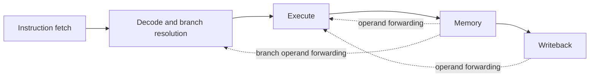

# Pipelined MIPS Processor

A 32-bit, five-stage SystemVerilog processor with data-hazard handling and custom multiply-accumulate and performance-monitor instructions. Developed for Advanced Digital Design and Verification at Arizona State University, Fall 2026.

## Architecture



- EX/MEM and MEM/WB forwarding, writeback bypass, and load-use stalls preserve dependencies.
- Decode-stage BEQ resolution flushes one wrong-path instruction on a taken branch. Operand dependencies can add stalls.
- `MULADD` computes the low 32 bits of `R[rs] * R[rt] + R[rd]`. A third register-file read port and accumulator forwarding support dependent operations.
- `PERFMON` exposes cycle and retired-instruction counters. Pipeline valid bits gate instruction retirement.

## Start with the design

| Read | What it shows |
| --- | --- |
| [Extended datapath](extended/datapath.sv) | Pipeline registers, operand selection, and forwarding |
| [Extended controller](extended/controller.sv) | Instruction decoding and control |
| [Performance monitor](extended/performance_monitor.sv) | Hardware counters |
| [MULADD testbench](extended/testbench_muladd.sv) | Directed custom-instruction checks |
| [Base synthesis status](base/SYNTHESIS_STATUS.txt) | Archived SRAM synthesis result and remaining violations |

## Recorded results

The submitted report includes ADD forwarding, BEQ flushing, and custom-instruction traces. Dependent MULADD operations produced 25 and 40 in adjacent execute cycles.

The **base pipeline with two OpenRAM SRAM macros** met a **1.25 ns setup constraint** in Synopsys Design Compiler using OSU FreePDK45. Reported worst setup slack was **+0.000710 ns**, with **44,028.01 µm²** total synthesized cell area. The archived status retains **2,640 max-capacitance violations**. This result applies to base-pipeline synthesis. The custom-instruction version has separate RTL and validation evidence.

## Simulation and dependencies

The original VCS/Verdi Makefiles and memory programs are included under `base/` and `extended/`. Use a disposable working copy because some targets replace `memfile.dat`. The supplied flows require a configured Synopsys installation and FSDB support.

```sh
cd extended
make sim_muladd
make sim_perfmon
```

These commands describe the archived flow. The portfolio export has not rerun VCS. The archived MULADD bench declares `N = 1` and also initializes index 2, which warrants review before relying on a fresh regression. The Part 2 Makefile contains duplicate `clean` rules and a synthesis target referencing an absent script. Use `base/compile_with_sram.tcl` for the documented base SRAM experiment after configuring your own technology paths. Obtain SRAM models and cell libraries from their providers.

## Evidence and scope

This is a source snapshot of the Fall 2026 submission. Original project files remain available for a technical discussion. Existing source comments are preserved, with student identifiers and machine-specific home usernames redacted from public text. The base SRAM setup result does not establish routed timing or timing of the extended instruction set.
